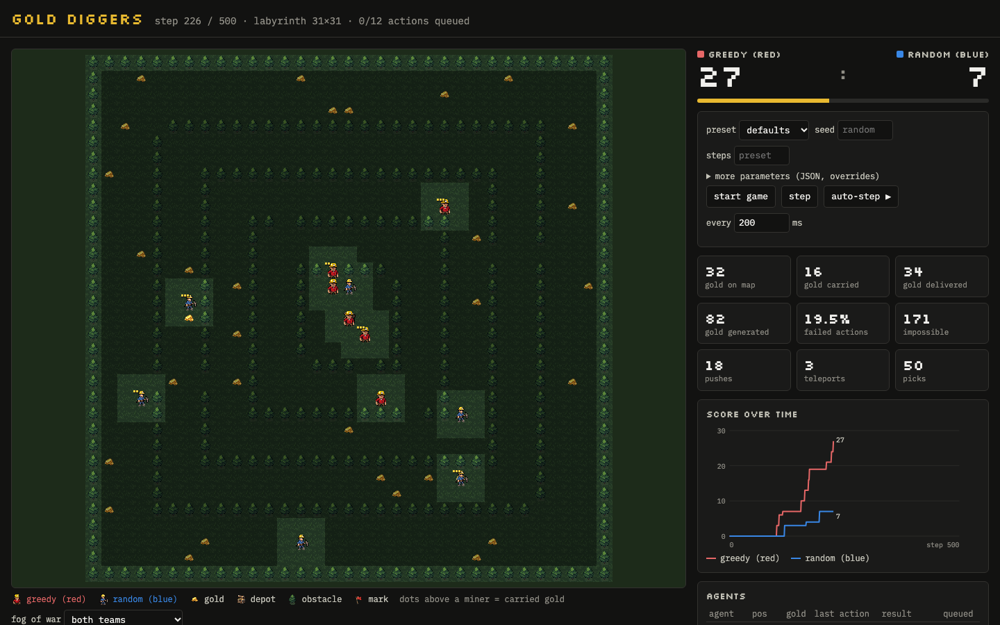
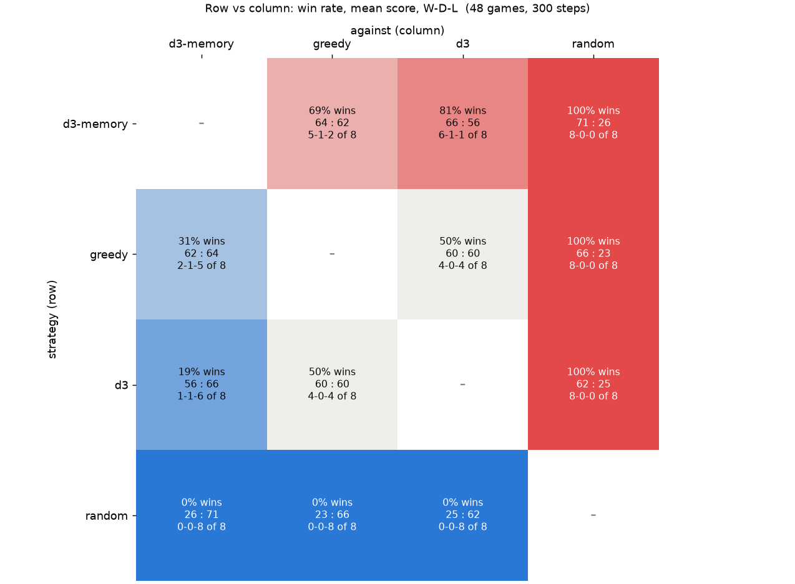

# golddiggers

A server for the Multi-Agent Programming Contest **Gold Miners** scenario (MAPC 2006/2007,
[multiagentcontest.org/2007](https://multiagentcontest.org/2007/)). Agents talk to it over a JSON API,
and a web frontend shows the map and statistics live. Unlike the original MASSim server, steps do
not advance on a timer. Something has to call `stepgame`: a driver script, the frontend's step
buttons, or an experiment harness. This makes slow agents, such as LLMs, a non-issue.



```sh
cd golddiggers
uv sync --extra dev --extra agents
uv run golddiggers --port 8642                      # frontend: http://127.0.0.1:8642/
uv run python agents/harness.py --start '{"preset": "mapc2007", "seed": 1}' --red greedy --blue random
uv run pytest -q
```

With Docker (port 8642, restarts with Docker; rebuild after code changes):

```sh
docker compose up -d --build        # in golddiggers/
docker compose logs -f              # docker compose down to stop
```

## API

All bodies and responses are JSON. Agent names are `<team><n>`, e.g. `red1`…`red6`, `blue1`…`blue6`.

| endpoint | what it does |
|---|---|
| `POST /api/startgame` | Starts a new game, replacing the current one. Body: any `GameConfig` field (below), plus an optional `"preset"`. Returns the config and, per agent, what MAPC's SIM-START gave: team, opponent, teammates, grid size, depot, steps, max_carry. |
| `GET /api/perceive/{agent}` | The perception for the current step. Repeated calls return the same data. |
| `POST /api/act/{agent}` | `{"action": "up"}` or `{"action": "mark", "param": "abc"}`. Queues the action for the next step. Calling it again replaces the queued action. |
| `POST /api/setteamname/{team}` | `{"name": "greedy"}`: a display name for the team (1-24 letters, digits, space, `_.-`). The frontend shows it as "greedy (red)". The example agents set their strategy name. |
| `POST /api/stepgame` | Resolves all queued actions at once. Agents with nothing queued skip. Returns the step number, the score, each agent's requested action and result, and events (push, delivery, teleport). |
| `GET /api/state` | The full world state for the frontend: obstacles, gold, agents, marks, score, stats, per-step history. |
| `GET /api/stats` | Numbers only: step, score, winner, gold on the map, carried gold, counters (generated, delivered, picks, failed, impossible, pushes, teleports), per team and per agent (moves, picks, delivered, failed, impossible, pushed others, got pushed, teleports). `?history=true` adds per-step score/carried/gold history. |
| `GET /api/field` | The field as text rows (`.` empty, `#` obstacle, `$` gold, `D` depot, `A`/`B` agents of the first/second team), plus legend, depot, marks and agents. |
| `GET /api/config` | Defaults, presets and the list of actions. |

FastAPI's interactive docs are at `/docs`.

Perception (`GET /api/perceive/red1`):

```json
{"agent": "red1", "team": "red", "step": 12, "steps": 500, "finished": false,
 "pos": [4, 7], "items": 1,
 "cells": {"nw": ["obstacle"], "n": ["empty"], "ne": ["gold", {"mark": "x1"}], "w": ["ally"],
           "cur": ["empty"], "e": ["enemy"], "sw": ["unknown"], "s": ["depot"], "se": ["empty"]},
 "last_action": "pick", "last_result": "ok",
 "sim": {"opponent": "blue", "width": 30, "height": 30, "depot": [4, 8], "...": "..."},
 "queued": null}
```

- Cells outside the grid are left out.
- `unknown` means the server withheld that cell (information distortion). It never reports a cell wrongly.
- When the game is over, the perception also carries `result` (win/lose/draw) and `score`.
- `last_result` is one of `ok`, `failed` (random failure or lost conflict), `impossible`, `pushed`, `teleported`. The original protocol had no such feedback. Agents had to infer it from the next perception.

## Rules (2007 spec, with the 2006 rules as a parameter set)

- **Grid:** x grows to the right, y grows downwards, (0,0) is the top-left corner. There is one depot, shared by both teams.
- **Actions:** `skip up down left right pick drop mark unmark`. A failed action counts as skip.
- **Carrying:** an agent carries up to `max_carry` items. `drop` in the depot delivers all of them, one point each. `drop` elsewhere puts one item on the cell.
- **Fatigue:** failure probability is `p = p_sim + (p_max - p_sim) / max_carry * items`. It applies to both action failure (`p_fail` → `p_fail_max`) and missing cells in the perception (`p_info` → `p_info_max`).
- **Pushing:** moving into an agent whose action this step resolves to skip pushes it one cell, if the cell behind it is free. If two agents move into each other, a coin flip decides who pushes.
- **Move resolution:** the spec's six-step algorithm. Moves only succeed into cells that were free at the start of the step, so agents can't follow each other in a line within one step.
- **Depot:** an agent can enter only while carrying gold, and must `drop` on its next action.
  What happens afterwards is set by `depot_policy`:
  - `original` (MAPC 2006/07): leave at the first chance, meaning when a neighbouring cell is free. An agent boxed in by others is never removed. Without pushing, agents queueing around the depot then deadlock it for the rest of the game.
  - `leave_or_teleport` (default): an agent still on the depot one step after dropping is teleported, boxed in or not.
  - `teleport_on_drop`: delivering teleports the agent away immediately, so nobody ever stands on the depot.

  A depot violator is teleported to the cell chosen by `teleport_target`:
  - `random` (original): any free cell. Luck decides whether that helps or hurts.
  - `ring` (default): a random free cell at walking distance `teleport_radius` (6) from the depot. The cost is the same for everyone.
  - `home`: the team's start cells. This is fair because maps are symmetric.

  Not dropping right after entering is always a violation.
- **Gold generation:** works as in the 2006 server code. Every `gold_frequency` steps, with probability `gold_probability`, `gold_number` items appear on random empty cells.

`GameConfig` fields and defaults: `map_type` (`random`|`labyrinth`|`rows`), `width` 30, `height` 30,
`obstacles` 90 (random maps only), `initial_gold` 40, `steps` 500, `teams` ["red","blue"],
`team_size` 6, `max_carry` 3, `pushing` true, `p_fail` 0.05, `p_fail_max` 0.3, `p_info` 0.05,
`p_info_max` 0.3, `gold_frequency` 10, `gold_probability` 0.8, `gold_number` 2,
`depot_policy` leave_or_teleport, `teleport_target` ring, `teleport_radius` 6, `seed` null.

Presets:

- `mapc2006`: 4 agents, carry 1, no pushing, 25×25, using the parameters of the 2006 Random1 map.
- `mapc2007`: 6 agents, carry 3, pushing, 40×40, using the parameters of the 2007 Meadow map.
- `labyrinth`: concentric walls around a central depot, like 2006 Labyrinth.
- `rows`: walls with a single gate at alternating ends, like 2006 Labyrinth1. Random exploration fails on this map.

The maps are generated, not the original hand-made ones.

## Frontend

Served at `/`, polling `/api/state` four times a second. It shows:

- the pixel-art map; hover a cell to see what is on it;
- scores and a step progress bar;
- stat tiles (gold on the map, carried, delivered and generated; failure rate; pushes; teleports);
- a score-over-time chart with a crosshair;
- an agent table.

Games are started through the API (`POST /api/startgame`), for example by the agent harness. The frontend only watches, and can step manually or with auto-step.

Sprites: the frontend uses `static/assets/<name>.png` (grass, tree, gold, depot, mark, miner0,
miner1) when the file exists, and otherwise falls back to built-in 16×16 pixel art.
`tools/gen_assets.sh` generates the sprites with Retro Diffusion (`general/skills/retro-diffusion-api`).
It is paid: about $1.26 per run.

## Agents (client side)

All agents run through one harness, [agents/harness.py](agents/harness.py). Only the strategy is pluggable.

- **The loop:** each step, every agent runs perceive → decide → act in its own thread, so model requests overlap. Then the harness calls `stepgame`, unless you pass `--no-drive`. Each team announces its strategy name via `setteamname`.
- **Per decision it records** the decision time (wall clock of `decide`, including any model request) and the prompt length in tokens (0 for rule-based strategies).
- **At the end of the run** (game over or Ctrl+C), it prints mean ± std per agent and per team, and writes `runs/<time>_<red>-vs-<blue>/` containing:
  - `decisions.jsonl`
  - `summary.json`
  - `report.png`: decision time and prompt length distributions per agent, plus score over time.

```sh
uv run python agents/harness.py --list-strategies
uv run python agents/harness.py --start '{"preset": "mapc2007"}' --red d3 --blue greedy
```

**Recording:** unless `--no-record` is passed, every step is saved to `steps/` in the run directory:
- `NNNNNN.png`: the field, rendered client-side from `/api/field` with the frontend's sprites, with fog of war unless `--no-fog`.
- `NNNNNN.json`: the server's numbers (`/api/stats`), the structured field (`/api/field`), and this step's client numbers: step wall time; per team mean/max decision time, mean/total prompt tokens, errors and the exact request bodies sent to the model; per agent action, decision time, prompt tokens, d3 probabilities and its prompt (task, situation, options).

A step's files show the state at that step plus the decisions the agents took from it. An 800-step game takes about 40 MB.

[tools/render_run.py](tools/render_run.py) turns a recording into frames or a video. Each frame shows the screenshot on the left. On the right are the score and counters, and charts up to that step: score, gold carried, gold on the map, decision time (log scale) and prompt length.

```sh
uv run python tools/render_run.py runs/<run> --step 120      # runs/<run>/frame_000120.png
uv run python tools/render_run.py runs/<run> --video         # runs/<run>/video.mp4, 10 fps
```

10 fps shows one step per frame slowly enough to follow single moves, and an 800-step game becomes an 80 s video. Change it with `--fps`.

Strategies ([agents/strategies.py](agents/strategies.py), registry `REGISTRY`):

- `greedy`: keeps a shared team map, goes for the nearest known unclaimed gold by BFS, delivers when full, and otherwise explores the nearest unseen cell.
- `random`: random walk, like the organizers' 2006 CLIMABot baseline. It picks up any gold it steps on and delivers it.
- `d3` ([agents/d3.py](agents/d3.py)): every action is chosen by a d3 decision model over `/v1/systemone`.
  - It talks to `--d3-url` (default `http://192.168.0.219:11490`, the port for all d3 models). At start it asks `/v1/models` which models are served, and uses `--d3-model` or the first one listed.
  - Per decision it computes *facts* (position, carried gold, view, and for each possible action the distance to the depot, gold and unexplored area). A prompt variant (`--d3-prompt`) turns the facts into a state text and one choice question. The model decides; the strategy only computes facts.
  - By default one request per team and step: the task text is the shared state, and each miner's situation is its own question. `--d3-no-batch` sends one request per agent.
  - Every decision logs its facts and its prompt (task, situation, options). The step files also hold the exact request bodies. `--d3-sample` draws from the probabilities instead of taking the most likely action.

- `d3-memory` ([agents/d3_memory.py](agents/d3_memory.py)): the `d3` strategy plus memory. The model still makes every move.
  - **Remembered gold target:** a miner keeps its assigned gold until it is picked up or gone. `d3` re-matches miners to gold every step, so targets can switch when teammates move.
  - **Split exploration:** an exploring miner gets its own unexplored target cell, at least 8 steps from its teammates' targets, and keeps it until the cell has been seen.
  - **Prompt v5:** the goal sentence states the remembered target ("You are heading to your gold, 3 steps away.").
  - **Routing around miners:** distances route around the miners next to an agent, so a side step shows as the way round a queue. A miner already carrying gold only targets gold within 6 steps; otherwise it delivers.
  - It always sends one request per team, and shares the `--d3-*` options.

  Fixing the first version (seed 2 against greedy):
  - **First version, 18 : 62:** full miners queued in one lane to the depot, with 661 failed moves.
  - **Routing around miners and delivering earlier, 41 : 62.**
  - **No coordinates in the goal sentence, 66 : 66.** "Your gold at [12, 16]", with no own position given, made d3 move the wrong way half the time in the oscillating cases (30/60 correct; 60/60 without the coordinate). The `d3` baseline scored 54 : 60 on this map.

Prompt variants, scored with d3-flash in the prompt lab (180 situations from a greedy game) and in 300-step games against `greedy` (mapc2007 preset; v3 and v4 summed over seeds 1–3):

| variant | what changes | lab: sensible | tokens | game vs greedy |
|---|---|---|---|---|
| `v0` | original: raw distances per move, "drop one gold here" offered | 74% | 488 | 1 : 80 (4 : 71 batched) |
| `v1` | no drop outside the depot; moves described as "closer to gold (5->4)" | 84% | 325 | – |
| `v2` | v1 plus the current goal as a fact ("You are full: deliver to the depot.") | 95% | 337 | – |
| `v3` | v2, but each move lists only the distances that matter for the goal | 96% | 266 | 166 : 187 |
| `v4` (default) | v3 with team coordination: miners are matched to gold, one miner per nugget | – | 260 | 179 : 185 |

What made the difference:
- `v0` miners spent 70% of their decisions picking gold up and dropping it again on the spot, because "drop one gold item here" was offered.
- An offered `skip` attracted the model too (about 50–90% with skip next to moves), so `skip` is offered only when no other action is possible.
- Stating the goal as a fact, and leaving out irrelevant distances, fixed most remaining mistakes.
- In the v3 game, 66% of gold-seeking decisions targeted the same nugget as a teammate, which led to the matching in v4.

Tools:
- [tools/d3_prompt_lab.py](tools/d3_prompt_lab.py) scores prompt variants offline. It samples logged situations by type (on depot, on gold, full, carrying some, empty with or without known gold), asks d3 in batches, and compares the answers with the sensible actions for that situation. Test sets come from any run: d3 always logs facts, and `greedy` does with `--greedy-log-facts`.
- [tools/bench_d3_batching.py](tools/bench_d3_batching.py) compares one request per agent with one batched request per team.

### Tournament

[tools/tournament.py](tools/tournament.py) plays every pairing of strategies on several seeds, each from both sides. It then builds a comparison matrix from all finished runs: `runs/tournament/matrix.md`, `.json` and `.png`. Games that already exist are skipped. `--since` makes only games played after a strategy change count.

```sh
uv run python tools/tournament.py play   --strategies random,greedy,d3,d3-memory --seeds 1,2
uv run python tools/tournament.py matrix --strategies random,greedy,d3,d3-memory
```

Result with d3-flash: 48 games of 300 steps on the mapc2007 preset (41×41), seeds 1–4, both sides. Each cell is the row strategy's wins-draws-losses against the column strategy, then the mean score row : column.

| | d3-memory | greedy | d3 | random | overall win rate |
|---|---|---|---|---|---|
| **d3-memory** | – | 5-1-2 · 64 : 62 | 6-1-1 · 66 : 56 | 8-0-0 · 71 : 26 | 83% |
| **greedy** | 2-1-5 · 62 : 64 | – | 4-0-4 · 60 : 60 | 8-0-0 · 66 : 23 | 60% |
| **d3** | 1-1-6 · 56 : 66 | 4-0-4 · 60 : 60 | – | 8-0-0 · 62 : 25 | 56% |
| **random** | 0-0-8 · 26 : 71 | 0-0-8 · 23 : 66 | 0-0-8 · 25 : 62 | – | 0% |



A new strategy subclasses `harness.Strategy`. It implements `decide(perception, team) -> Decision(action, prompt_tokens)` and is added to `REGISTRY`. While touching `team.memory`, hold `team.lock`, but not while waiting for a model.

## References

This is an independent reimplementation for experiments. It is not the official software.
The scenario, rules and protocol come from the Multi-Agent Programming Contest (MAPC) and its
MASSim simulation server, organized by Clausthal University of Technology and Utrecht University
(Mehdi Dastani, Jürgen Dix, Peter Novák).

- **Contest:** [multiagentcontest.org](https://multiagentcontest.org/), with the
  [2006 (CLIMA VII)](https://multiagentcontest.org/2006/) and [2007](https://multiagentcontest.org/2007/) editions.
- **Original specs:**
  - 2006: [scenario](https://multiagentcontest.org/2006/c7c-scenario-final.txt), [protocol](https://multiagentcontest.org/2006/c7c-protocol.txt)
  - 2007: [scenario](https://multiagentcontest.org/2007/ac07-scenario-extended.txt), [protocol](https://multiagentcontest.org/2007/ac07-protocol.txt)
- **Original MASSim 2006 server** (Java), monitor and demo agents: downloads on the [2006 page](https://multiagentcontest.org/2006/).
  The current MASSim is at [github.com/agentcontest](https://github.com/agentcontest).
- **Organizer reports:**
  - M. Dastani, J. Dix, P. Novák: *The Second Contest on Multi-Agent Systems Based on Computational Logic*,
    CLIMA VII, LNAI 4371, 2007 ([doi](https://doi.org/10.1007/978-3-540-69619-3_15),
    [tech report IfI-06-13](https://multiagentcontest.org/publications/ifi0613dastani.pdf))
  - M. Dastani, J. Dix, P. Novák: *Agent Contest Competition: 3rd Edition*, ProMAS 2007, LNAI 4908, 2008
    ([doi](https://doi.org/10.1007/978-3-540-79043-3_14),
    [tech report IfI-07-15](https://multiagentcontest.org/publications/ifi0715dastani.pdf))
  - T. Behrens, M. Dastani, J. Dix, M. Köster, P. Novák: *The Multi-Agent Programming Contest from 2005–2010:
    From Collecting Gold to Herding Cows*, Annals of Mathematics and Artificial Intelligence 59, 2010
    ([doi](https://doi.org/10.1007/s10472-010-9219-5),
    [tech report IfI-10-14](https://multiagentcontest.org/publications/ifi1014behrens.pdf))
  - T. Ahlbrecht, J. Dix, N. Fiekas, T. Krausburg: *The Multi-Agent Programming Contest: A résumé*
    ([arXiv:2006.02739](https://arxiv.org/abs/2006.02739))
- **The Jason gold-miners teams** (2006 winner and 2007 entry):
  [examples/gold-miners](https://github.com/jason-lang/jason/tree/master/examples) in the Jason distribution.

Differences from the original are described above:
- explicit stepping instead of timed steps;
- JSON over HTTP instead of XML over TCP;
- point-symmetric maps;
- configurable depot policies;
- extra perception feedback (`last_action`, `last_result`).

